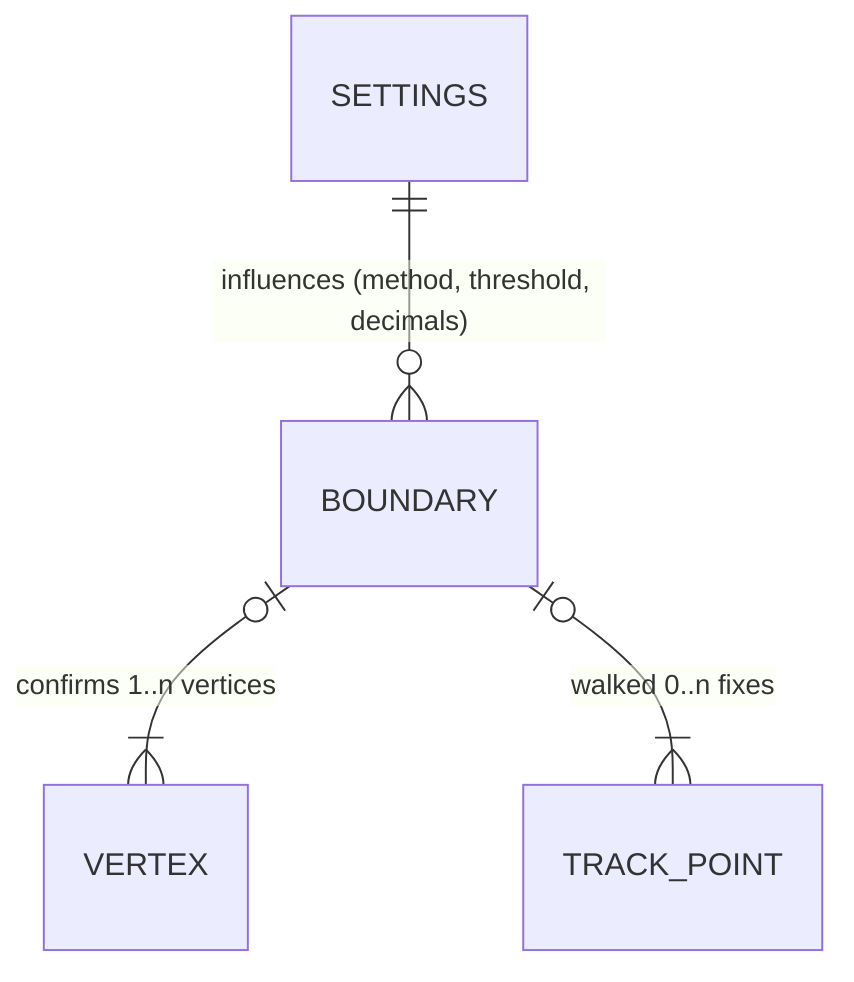
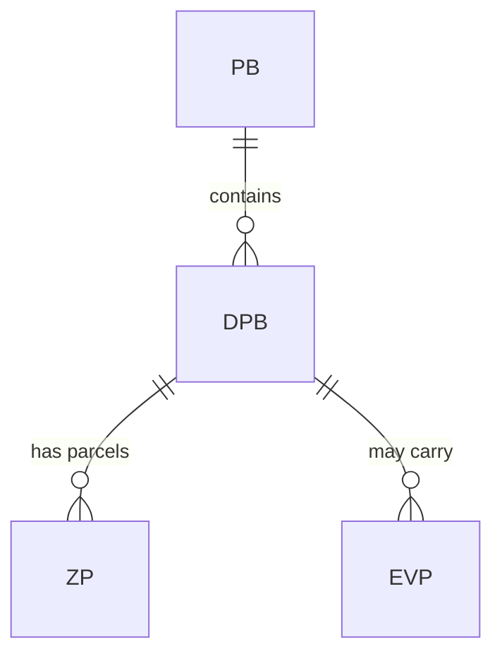
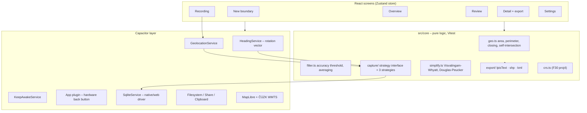
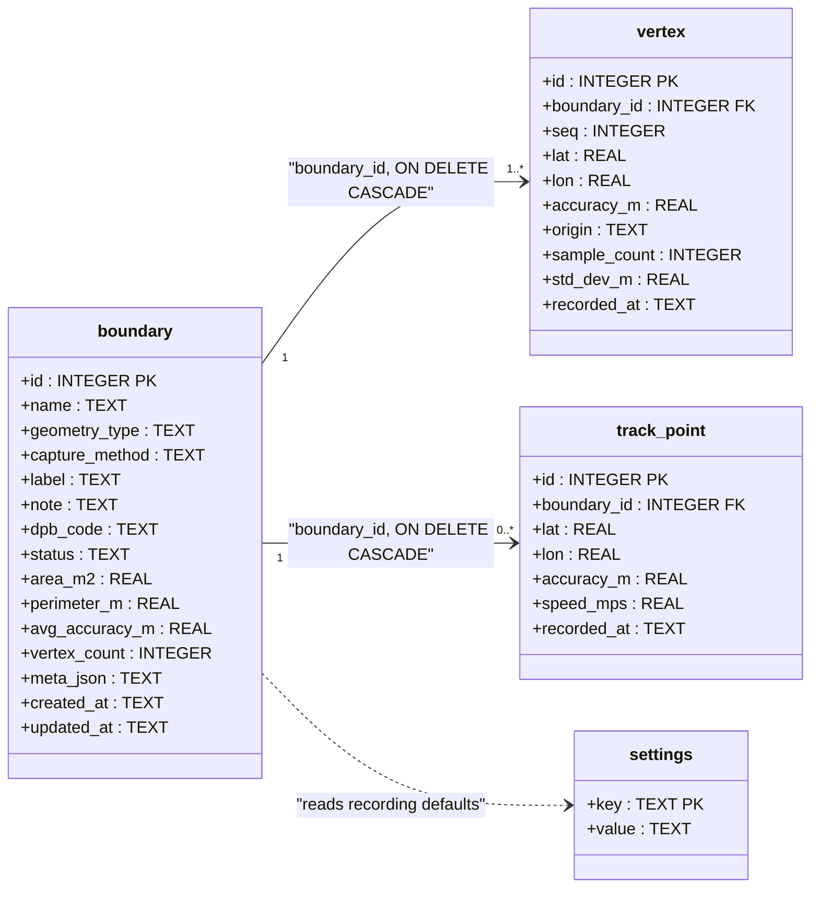
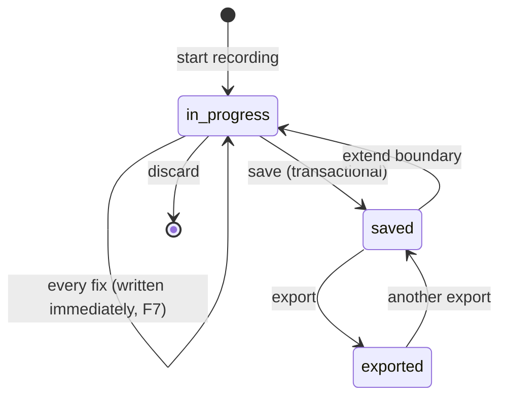
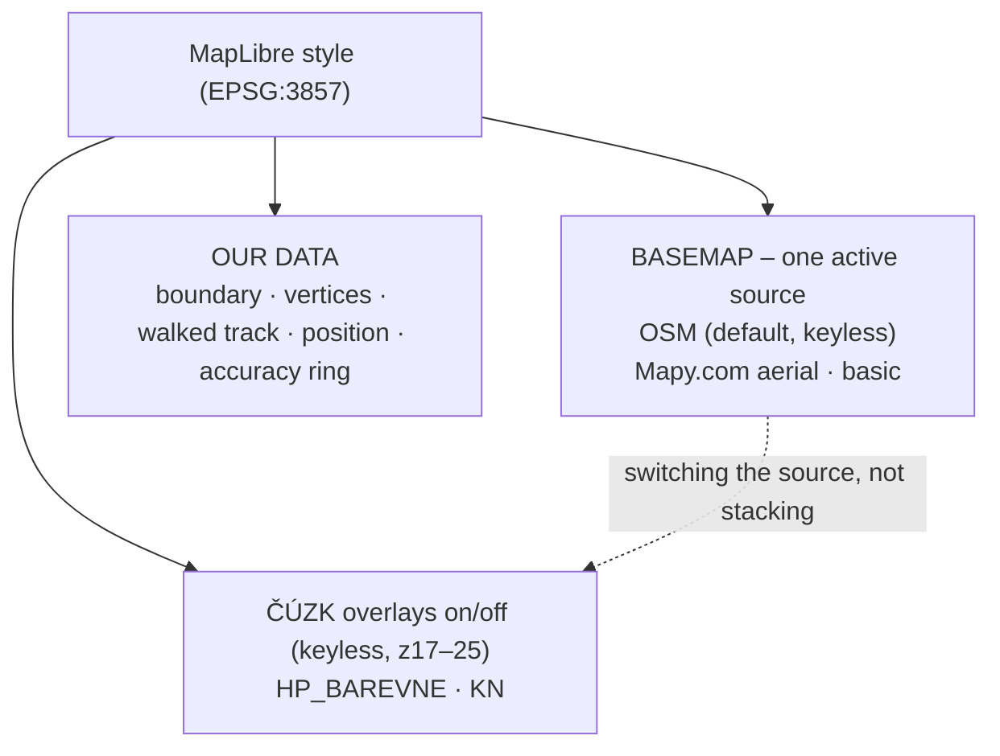
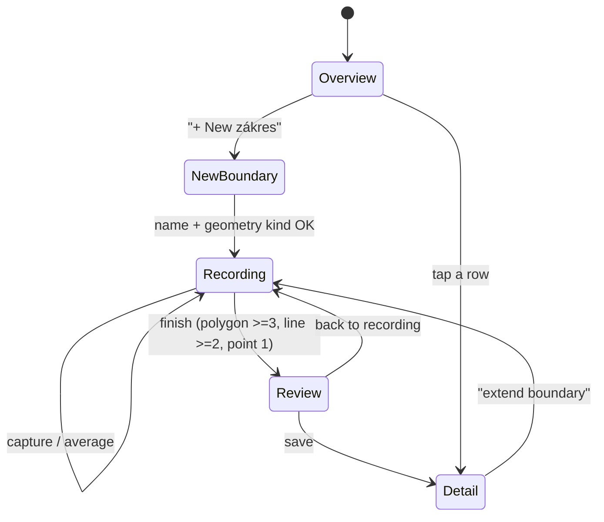

# Specification

How Parcelex will be built. The *why* and the research are in
[analysis.md](./analysis.md); the plan is in [timeline.md](./timeline.md).

Requirement IDs (F…), risk IDs (R…) and milestone IDs (M…) are defined there and are stable.

**Our object is a `boundary`** (Czech UI: *zákres*). Where this document quotes iLPIS's own wording —
"New measurement from coordinates", the PZ/PZL/PZB tools — that is the registry's vocabulary and is
not renamed.

**The exact wording of every UI string is in [ui-text.md](./ui-text.md)**, Czech plus English. This
document says what a screen does; ui-text.md says what it says.

---

# A. Binding decisions

| Area | Decision |
|---|---|
| Platform | Capacitor (TS + React). Android first, iOS in M8, web as development platform. |
| Storage | SQLite (`@capacitor-community/sqlite`) on Android/iOS **and** web (WASM + OPFS). |
| Output CRS | WGS-84 primary. S-JTSK quadrant III export behind F30. No CRS code in the MVP. |
| Export targets | 1) paste text (primary), 2) ZIP SHP, 3) KML (underlay only — iLPIS makes no feature from it). |
| Feature type | Not stored. Optional free-text `label`, never validated. iLPIS asks for the type at paste time. |
| Geometry kind | `polygon` / `line` / `point`, mandatory, chosen before recording (F1b). |
| Capture method | **Three interchangeable strategies** (manual, walk-and-simplify, corner-detect) behind one interface; user-selectable, remembered, one default. The raw walked track is always stored (§E.3). |
| Screen | **Kept awake while recording.** No background location, no foreground service, no `ACCESS_BACKGROUND_LOCATION`. |
| Map renderer | MapLibre GL JS behind our own React component. No `react-map-gl`, no draw library. |
| Basemaps | Default OSM + ČÚZK cadastral — **works with no API key**. Mapy.com `aerial` behind a key in `.env`. |
| Offline | Automatic tile cache in the MVP. Manual area download not scheduled. |
| Identifiers | English in code and DB. **UI text localised, Czech primary.** Domain acronyms (LPIS, DPB, EVP, KML) untranslated. |
| Localisation | i18next + react-i18next, `cs` and `en` JSON resources, `cs` fallback, system locale default, manual override. No string literal in a component. |

---

# B. Normative rules

The precise behaviour each user story requires. Where a story is not listed here, its plain
wording in [analysis §2](./analysis.md#2-user-stories) is the rule.

## B.1 Boundary and geometry

| ID | Rule |
|---|---|
| F1 | Name required, default `DD.MM. HH:mm`. Geometry kind required (three tiles, default polygon). Label optional free text with suggestions `Parcela`, `EVP`, `Erozní pozemek`, `Mez`, `Remízek`, `Plot`, `Cesta`, `Jiné` — never validated, blocks nothing. Note and DPB code optional. Timestamp automatic. **Nothing else may be required before recording starts.** |
| F1b | **polygon** ≥ 3 vertices, closing error, area *and* perimeter, map fill, SHP `Polygon`, KML `Polygon`, iLPIS tool PZ. **line** ≥ 2 vertices, **no closing error, no area**, perimeter = length, no fill, SHP `PolyLine`, KML `LineString`, tool PZL. **point** exactly 1 vertex, nothing derived, SHP `Point`, KML `Point`, tool PZB. Kind is changeable until save, immutable after. |
| F5 | Closing error = distance last→first, warn above max(15 m, 3 × mean accuracy). Self-intersection warning. Polygon only. |
| F7 | Every fix is written immediately with `boundary.status = 'in_progress'`; save is one transaction. On start, `in_progress` rows prompt *Continue / Discard*. |

## B.2 Recording

| ID | Rule |
|---|---|
| F2 | One capture method is active at a time (§E.3). The recording screen exposes only that method's control — never three at once. Status strip: point count, current accuracy (m), distance to last point, running area + perimeter (line: length only; point: neither). Position reacquired ≤ 3 s. |
| F2b | The method chosen in settings is preselected on every new boundary and remembered between sessions. Default `manual`. Changing it mid-recording is allowed and applies to points added afterwards; already-captured vertices are kept. |
| F3 | Available in **all** methods: holding the average button collects samples for **as long as it is held**, showing the live count and spread; on release stores the mean plus `sample_count` and `std_dev_m`. Warn if `std_dev_m > 3 m`. A hold under 5 s or under 3 samples is treated as a plain point (`method = 'manual'`, `sample_count = 1`) so a slip of the thumb cannot store a single noisy fix labelled as an average. **There is no averaging-duration setting** — the hold *is* the control. |
| F4 | Fixes with `accuracy > threshold` (default 10 m, range 3–30 m) or non-finite accuracy are discarded with a visible indication. No vertex is stored without accuracy. A vertex within 0.5 m of the previous one is not added. A fix above 8 m/s (a run, not a walk — a phone left in a moving vehicle) is recorded as a track point but never proposed as a vertex, and the session warns once when it happens. |
| F6 | Review shows a vertex table (order, coordinates, accuracy, origin). Add vertex at the current position, add at a point on the walked track, delete, undo, redo, reverse, **drag to move**. Derived values and warnings recompute on every edit. Review is reachable from all three methods and is the only way a boundary is confirmed. |
| F9a | Position dot with an accuracy ring **scaled in metres**, heading arrow, centre-on-me, follow mode that disengages on manual pan. Auto-zoom ≈ z19 and keep centred while recording. |
| F9b | Continuously visible while recording: line + semi-transparent fill (polygon only), vertices as dots (**unnumbered** — order comes from the review list), dashed segment to the current position, dashed red closing line to the first point **with its length in metres** (polygon only), live `area · perimeter · vertex count` readout, haptic pulse on each added vertex. |
| F9c | The raw walked track is drawn as a thin grey line under the boundary for the whole session and can be hidden with one toggle. It is never exported. |
| F14 | Settings: capture method, accuracy threshold, decimal places, close polygon (polygon only), basemap, language, key state. **No other recording setting exists in the MVP.** |
| F39 | **Location permission.** Declares `ACCESS_FINE_LOCATION` + `ACCESS_COARSE_LOCATION` and `<uses-feature android:name="android.hardware.location.gps" android:required="true"/>`; never `ACCESS_BACKGROUND_LOCATION`. The app asks **when the user starts recording**, not at install, and shows a one-screen explanation first (*why*: the app records where you walk). `Geolocation.requestPermissions()` maps fine → `granted`, coarse-only → `limited`. **Coarse is not usable here** — its accuracy is kilometres, so every fix would fail the F4 threshold: the app states this and offers a deep link to system settings rather than starting a session that can only fail. On denial the app is fully usable for browsing saved boundaries. Re-asking happens on the next *start recording*, never on app open, and after two denials the explanation screen links to settings instead of calling the API again. |
| F40 | **Hardware back button is intercepted on every screen.** Overview: confirm and exit. New boundary: discard the draft, no confirm (nothing of value typed). Recording: opens *Finish / Keep recording* — never leaves directly. Review: returns to recording, keeping vertices. Detail and Settings: return to overview. Back never saves and never deletes; the only destructive back is the draft, which holds no geometry. |
| F41 | **No-fix state.** Until the first fix passes F4, the recording screen shows `error.noGps`, the map is centred on its last known position or Czechia, and both capture buttons are disabled with their reason visible. A fix older than 10 s marks the status strip stale (dimmed accuracy, capture disabled) — a stale fix on the map looks exactly like a live one, which is the failure that quietly ruins a shape. |
| F9 | Basemap selector offers imagery, plain map and the ČÚZK cadastral overlay. Imagery is the advertised default once a key exists; OSM is the default without one (F17). |
| F9d | One active basemap source, switched not stacked; ČÚZK overlays stack on top. Sources declare their real zoom range and MapLibre overzooms beyond it — aerial ends at z20 while cadastral runs to z25 (R9), so the user must never see an empty tile. |
| F8 | Overview lists boundaries newest first with name, kind icon, area or length, **average accuracy badge**, date and status; free-text search over name and label; filter by kind and label. Tapping a row opens Detail; a boundary with `status = 'in_progress'` is offered as *Continue* instead. Detail shows the same badge with the threshold it was recorded under, from `meta_json`. |

## B.3 Export

| ID | Rule |
|---|---|
| F10 | Text exactly per §D.1. Copy to clipboard, save as `<name>_WGS84.txt`, system share, live preview. |
| F10b | **`close_polygon`** (default **on**, polygon only) repeats the first vertex as the last line. Off, the ring is left open and iLPIS closes it — the manual's own S-JTSK example is unclosed, so both are accepted and the switch exists because we could not confirm which iLPIS prefers. It has **no effect on `line` or `point`** and never on the stored geometry, only on the exported text. The preview shows the exact bytes, so the user can see what the switch did. |
| F11 | ZIP with `.shp` `.shx` `.dbf` `.prj`, EPSG:4326, one feature per boundary, geometry per F1b. |
| F12 | KML per §D.3, with a visible warning that iLPIS will not create a feature from it. |
| F13 | Backup file `parcelex-backup-YYYY-MM-DD.sqlite`; import confirms and takes its own backup first. The walked track is included — it is part of the record. |
| F15 | Recording, saving, history and export work offline. Tiles cached automatically — anything displayed stays available. |
| F16 | Attribution follows the active source: Mapy.com → `© Seznam.cz a.s. a další` linking `https://api.mapy.com/copyright` **plus** clickable `https://api.mapy.com/img/api/logo.svg` as a map control; ČÚZK → citation per their terms; OSM → `© OpenStreetMap contributors`. |
| F17 | With an empty or invalid key the app is fully usable on OSM + ČÚZK; aerial is not offered. Key state is probed at startup by **requesting a known tile and checking the `Content-Type`**, never the HTTP status code — both Mapy.com and ČÚZK answer `200` with an error *image* (analysis §4.4). |

## B.4 Later phases

| ID | Rule |
|---|---|
| F18 | "Open in Mapy.com" via `https://mapy.com/fnc/v1/showmap?center=lon,lat&…` — no key, no attribution, opens the native app. Not MVP. |
| F21 | A walked side of any length contributes at most one vertex per detected corner; the simplification threshold is a constant in `core/simplify.ts`, not a user setting. P2 — `manual` capture never adds straight-side noise, so this only matters from `walk_simplify` (M6) onwards. |
| F25 | PDF protocol must not embed a stored Static Maps image — draw the underlay ourselves or omit it. |
| F30 | S-JTSK quadrant III via `proj4`, 7-parameter transform, tested against reference points. |
| F32 | Machine formats (Trimble, Topcon, RAVEN, CHCNAV). **Not designed** — no sample file from a real machine yet, and guessing a proprietary format is worse than waiting. |
| F36 | Elevation from `/v1/elevation` (≤ 256 points per request). Optional — a boundary is never rejected for lacking it. |
| F37 | Cadastral area from `/v1/rgeocode`, only when online. |

## B.5 Localisation

| ID | Rule |
|---|---|
| F38 | `cs` and `en` resource files ship in the app. Initial language = device locale, `cs` for any unsupported locale. The user can override in settings; the choice persists. |
| F38a | **No string literal in a component.** Every user-visible string comes from `t('…')`. A missing key renders the key itself, so it is visible in testing rather than silently English. |
| F38b | Counts use i18next plural blocks with all four Czech categories (`one`, `few`, `many`, `other`). `many` is for decimals; **5 and up is `other`** (analysis §4.9). A test asserts `1 → "1 bod"`, `3 → "3 body"`, `5 → "5 bodů"`. |
| F38c | Display formatting uses the active locale (`Intl`, Czech comma decimal mark). **Export text never does** — §D.1 output is always dot-decimal, `latitude longitude`, regardless of language. |
| F38d | `en` is a translation of `cs`, never the reverse. Wording decisions are recorded in [ui-text.md](./ui-text.md), not only in the JSON. |

## B.6 Cross-cutting

These come from [analysis §3](./analysis.md#3-what-the-app-must-be-like) and bind every screen.

| Rule |
|---|
| **Performance.** Overview renders 500 boundaries without a perceptible pause (paged list, geometry not loaded until a row is opened). The recording loop does one `setData` swap per source per second and creates no layer after startup. |
| **Ergonomics.** Primary controls ≥ 48 dp, reachable one-handed with the thumb; the two recording buttons are the largest targets on screen. Text stays readable in direct sunlight (high contrast, no grey-on-grey). Nothing requires two hands or a keyboard. |
| **Offline honesty.** Any action that needs the network says so before it fails, and no action that works offline is blocked by a failed network check. |
| **No dead ends.** Every error states what happened and what to do next; every destructive action is confirmable or undoable. |

---

# C. Domain model

| Level | Where | Question | Notation |
|---|---|---|---|
| Ours | C.1 | the four concepts the app has | `erDiagram` |
| Registry context | C.2 | the world our `dpb_code` points into, which we deliberately do not model | `erDiagram` |
| Relational | E.2 | what we store, and why nothing else | `classDiagram` |
| Data | E.2 | DDL, types, indexes, constraints | SQL |

## C.1 Our model

The app has exactly four concepts. Everything else in this chapter is context, not content.



`settings` is one concept that is physically a multi-row K/V table, and a boundary has **two** kinds
of point — see C.3 for why that split is the whole design.

| Entity | What one of them is | Lives as |
|---|---|---|
| **boundary** | one field action: one walk, one shape, one thing to export. Carries the name, the geometry kind and the metadata the user typed. | table |
| **vertex** | one confirmed corner. Ordered, and the only thing the export and the area come from. | table |
| **track point** | one fix the phone took while walking, which the user never confirmed. Evidence for the walked line and for re-deriving vertices; never exported. | table |
| **settings** | the user's recording preferences. Read when recording starts, stamped into the boundary. | K/V table |

Everything the app shows is derived from these four: the overview list, the map, the area, the
export text. There is no hidden fifth store.

## C.2 Registry context — deliberately not in the model

The farmer's world is bigger than our four tables, and one field of ours (`dpb_code`) points into it,
so the shape of it has to be written down somewhere. It is **not** part of our model: we hold no
registry data, so there is nothing to validate against, nothing to join to, and no reason to
re-implement someone else's schema offline.



What we take from it, and nothing more:

- a boundary may carry a **DPB code as free text** — a label the user types so they can find the
  record again, not a foreign key, because there is no DPB entity to point at;
- the user's own **label** (`Parcela`, `EVP`, …) is free text for the same reason;
- the geometry kind, not the registry feature type, is what drives the export
  ([lpis-findings.md §4](./lpis-findings.md)).

If we ever load the [public LPIS export](https://eagri.cz/public/app/eagriapp/lpisdata) as an
underlay, this diagram becomes real — that is exactly why it is drawn here and kept out of §E.2.

## C.3 Glossary

- **Boundary** (`zákres`) = one continuous field action: one walk, one shape, one thing to export.
- **Vertex** = a point the user *confirmed*. Vertices are the product: they are what the export
  contains, what the area is computed from, and what review edits.
- **Track point** = a fix the phone took while walking, which the user never confirmed. It is
  evidence, not output: it draws the walked line (F9c), it lets a missed corner be recovered in
  review (F6), and it lets the capture method be re-run later. **Never exported.**
- **Settings** = the user's recording preferences, read when a boundary starts and stamped into that
  boundary's `meta_json`. It is not user data and is never exported — it is why the app can behave
  differently for two farmers without either touching code, and why an old boundary stays
  interpretable after the defaults change.
- **PB** soil block = a physical field. **DPB** = part of one. **ZP** agricultural parcel = one year
  and crop; a DPB may carry several, each with its own geometry. **EVP** = ecologically significant
  elements. Context only (C.2).
- Area is computed **informationally**; the official figure is LPIS's, computed in the S-JTSK plane.

---

# D. Output formats

## D.1 Paste text — iLPIS "New measurement from coordinates" → "Enter coordinates"

Rules from the manual: one point per line; separator is a space; decimal mark dot **or** comma;
WGS-84 in decimal degrees only; order **`latitude longitude`**; an index and description may
precede each line; S-JTSK as negative quadrant III (`−Y −X`).

Default output — WGS-84, 7 decimals (≈ 1 cm), polygon closed:

```
1 50.6010896 15.0209397
2 50.6006702 15.0219671
3 50.6013311 15.0224410
4 50.6010896 15.0209397
```

Switches: index + description (off by default, in case LPIS mis-parses the prefix), close polygon
by repeating the first point (**on** by default, rule **F10b**, and only for
`geometry_type = 'polygon'` — closing a line would silently make a double loop), decimal places (7),
S-JTSK (F30, `1 -695034.11 -989920.15`).

For a line the format is identical but unclosed and the guide says to use the PZL tool; for a point
the app offers a single PZB point. **Track points are never exported** — only confirmed vertices.

## D.2 SHP

ZIP with `*.shp`, `*.shx` `*.dbf`, `*.prj`; EPSG:4326. Geometry per F1b. DBF fields (10-character
names): `ID`, `NAME`, `LABEL` (the user's label — LPIS derives nothing from it), `AREA_M2` (polygon
only), `LENGTH_M` (polygon = perimeter, line = length), `DATE`, `VERTEX_COUNT`.

Bulk import of multiple features is disallowed for agricultural parcels, erosion plots and OPV, so
F24 must warn "for ZP/VEP, import individually".

## D.3 KML

Polygon: `<Polygon><outerBoundaryIs><LinearRing>` with last point = first point. Line:
`<LineString>`, unclosed. Point: `<Point>`. Coordinates `lon,lat,alt` — **the opposite of our text
export** (R12). `name` = boundary name, `description` = label, date, area/length, vertex count,
note.

---

# E. Implementation

This chapter is also where **details discovered while implementing** are recorded, not only
decisions made beforehand. Add to it when the build teaches us something.

## E.1 Structure



```
src/
  core/
    geo.ts            # geodesic area, perimeter, closing, self-intersection
    filter.ts         # accuracy threshold, averaging, statistics
    simplify.ts       # Visvalingam-Whyatt (primary), Douglas-Peucker (comparison)
    capture/          # CaptureStrategy.ts · manual.ts · walkSimplify.ts · cornerDetect.ts
    types.ts          # Boundary, Vertex, TrackPoint, GeometryType, CaptureMethod
    geo/point.ts      # { lat, lon } + toMapyPair() / toLpisPair() — the ONLY conversions
    export/           # lpisText.ts · shp.ts · kml.ts · zip.ts
  i18n/               # config.ts · locales/cs.json · locales/en.json
  db/                 # schema.ts · BoundaryRepo.ts · StorageDriver.ts
  services/           # GeolocationService.ts · PermissionService.ts · HeadingService.ts · KeepAwakeService.ts · SettingsService.ts
  map/                # basemaps.ts · layers.ts · useMap.ts
  ui/                 # screens/ components/ store/
test/                 # Vitest: core/**, db/**
```

Libraries: see [analysis §5](./analysis.md#5-technology-available). `mermaid` and `jsdom` are
devDependencies for `docs:lint`.

## E.2 Data model

Four tables, one relation — a single-user offline tool, not an information system.



```sql
PRAGMA foreign_keys = ON;

CREATE TABLE boundary (
  id             INTEGER PRIMARY KEY AUTOINCREMENT,
  name           TEXT    NOT NULL,
  geometry_type  TEXT    NOT NULL CHECK (geometry_type IN ('polygon','line','point')),
  capture_method TEXT    NOT NULL CHECK (capture_method IN ('manual','walk_simplify','corner_detect')),
  label          TEXT,                       -- user's own text, NOT an iLPIS feature type
  note           TEXT,
  dpb_code       TEXT,                       -- free text, no FK: we have no DPB entity
  status         TEXT    NOT NULL DEFAULT 'in_progress'
                          CHECK (status IN ('in_progress','saved','exported')),
  area_m2        REAL,                       -- informational; polygon only
  perimeter_m    REAL,                       -- polygon=circumference, line=length, point=NULL
  avg_accuracy_m REAL,                       -- quality badge in overview + detail
  vertex_count   INTEGER NOT NULL DEFAULT 0, -- denormalised so the list needs no COUNT
  meta_json      TEXT,                       -- settings in force while recording
  created_at     TEXT    NOT NULL,           -- ISO 8601 with time zone
  updated_at     TEXT    NOT NULL
);
CREATE INDEX idx_boundary_created  ON boundary(created_at DESC);
CREATE INDEX idx_boundary_geometry ON boundary(geometry_type);
CREATE INDEX idx_boundary_label    ON boundary(label);

CREATE TABLE vertex (
  id           INTEGER PRIMARY KEY AUTOINCREMENT,
  boundary_id  INTEGER NOT NULL REFERENCES boundary(id) ON DELETE CASCADE,
  seq          INTEGER NOT NULL,             -- 0..n-1
  lat          REAL    NOT NULL,             -- WGS-84, source of truth
  lon          REAL    NOT NULL,
  accuracy_m   REAL    NOT NULL,
  origin       TEXT    NOT NULL
                        CHECK (origin IN ('manual','average','detected','simplified','edited')),
  sample_count INTEGER NOT NULL DEFAULT 1,
  std_dev_m    REAL,
  recorded_at  TEXT    NOT NULL,
  UNIQUE (boundary_id, seq)
);
CREATE INDEX idx_vertex_boundary ON vertex(boundary_id, seq);

CREATE TABLE track_point (
  id          INTEGER PRIMARY KEY AUTOINCREMENT,
  boundary_id INTEGER NOT NULL REFERENCES boundary(id) ON DELETE CASCADE,
  lat         REAL    NOT NULL,
  lon         REAL    NOT NULL,
  accuracy_m  REAL    NOT NULL,
  speed_mps   REAL,                           -- drives the "was moving too fast" filter
  recorded_at TEXT    NOT NULL
);
CREATE INDEX idx_track_boundary ON track_point(boundary_id, id);

CREATE TABLE settings (key TEXT PRIMARY KEY, value TEXT NOT NULL);
-- keys: capture_method, accuracy_threshold_m, decimals,
--       close_polygon, basemap, language
```

### Why each column is stored rather than computed

`lat/lon` are the **only** source of truth. Everything else is either something the user typed, or a
cache with a stated reason. A column that has no reason does not belong in the schema — two were
dropped on exactly that basis, below.

| Column | Why it is stored |
|---|---|
| `name`, `label`, `note`, `dpb_code` | the user typed them; nothing to compute. |
| `geometry_type` | decides the whole export shape (F1b) and is immutable after save, so it must be recorded, not inferred from the vertex count — 3 vertices could be a triangle or the start of a line. |
| `capture_method` | which strategy produced this. Without it the M7 field test cannot compare methods, and a re-run cannot reproduce what happened. |
| `status` | the lifecycle (§E.2 diagram) and crash recovery in one column. |
| `area_m2` | **a cache, not a fact.** Geodesic area is expensive enough to matter on a 500-row list, so it is stored at save and recomputed whenever vertices change. Always labelled informational — the official figure is LPIS's. |
| `perimeter_m` | same, and it carries double meaning by design: circumference for a polygon, length for a line, `NULL` for a point (F1b). |
| `avg_accuracy_m` | the quality badge in the overview and detail — "this boundary was recorded in a hedge, that one in open field". It is the one number that tells the user whether to trust the shape before opening it. |
| `vertex_count` | denormalised so the overview list is one query with no `COUNT(*)` per row (B.6 performance). |
| `meta_json` | **a snapshot, not a cache.** The settings in force while recording: threshold, decimals, basemap, method. Settings are editable and shared, so reading them later would describe today's user, not the recording. This is what makes an old boundary interpretable after the defaults change, and what makes the M7 comparison honest. |
| `created_at`, `updated_at` | ordering (F8), the default name, and the export `DATE` field. |
| `vertex.seq` | the order *is* the geometry — a polygon is its vertices in order. `UNIQUE (boundary_id, seq)` makes a reordering bug fail loudly instead of producing a bowtie. |
| `vertex.accuracy_m` | colours each vertex so the user knows which point to nudge in iLPIS (§E.4). |
| `vertex.origin` | how the point got there (`manual`/`average`/`detected`/`simplified`/`edited`). Shown in the review table (F6) — a `simplified` vertex deserves more scrutiny than one the user pressed. |
| `vertex.sample_count`, `std_dev_m` | how much averaging went in and how scattered it was; `std_dev_m > 3 m` is the F3 warning. Without them an averaged point is indistinguishable from a single fix. |
| `track_point.speed_mps` | separates "walked the parcel" from "drove past it with the phone in a pocket" — a real field failure, and only visible after the fact. |
| `track_point.recorded_at` | time order, and the gap detection that explains a missing stretch of track. |

**Dropped for having no consumer:** `boundary.track_count` (a count of evidence nobody displays) and
`track_point.bearing` (unreliable at walking speed per analysis §4.2, and `corner_detect` uses the
rotation vector instead — so it would have been stored, never read). Earlier tables dropped on the
same test are recorded in [CHANGELOG.md](./CHANGELOG.md).

Settings are read-only for a boundary: the values in force at recording time are stamped into
`meta_json`, so it stays recoverable under what conditions something was measured.

**Why `track_point` exists.** Analysis §4.3 concluded *store the raw track, derive the boundary from
it*. At 1 Hz and walking speed that is ~1.4 rows per metre — a few hundred rows for a whole parcel,
negligible for SQLite. It is what makes the capture method a *view* over data we already have: the
method can be switched, re-run or improved later without losing anything the user walked, and it is
what F9c draws. It also means a missed corner in `walk_simplify` is recoverable, because the fix you
walked past is still in the table (F6).

**Tables deliberately absent:** `in_progress` (it is `boundary.status`), `feature_type` (iLPIS asks
at paste time), `export` (`status` suffices until we need export history), `photo` (no requirement),
`sample` (a sample only ever exists inside one averaging press; its result is a `vertex` with
`sample_count`/`std_dev_m`).



Crash recovery = `SELECT * FROM boundary WHERE status = 'in_progress'` at startup. The
`saved → in_progress` transition is why `status` cannot be a done flag.

## E.3 Capture strategies

One interface, three implementations, chosen by `settings.capture_method`. All three consume the
same filtered fix stream and produce the same vertex list; none of them knows about the map or the
UI.

```ts
export interface CaptureStrategy {
  readonly method: CaptureMethod;
  /** Every accepted fix. Implementations must be pure functions of this stream. */
  onFix(fix: Fix): CaptureEvent[];
  /** User held the average button; the strategy returns the vertex it produces. */
  onAverage(samples: Fix[]): VertexDraft;
  /** End of recording. Flush anything pending (e.g. the last corner of a walk). */
  flush(): VertexDraft[];
}
```

| Strategy | `onFix` does | Produces | Needs |
|---|---|---|---|
| `manual` | store the fix as a track point only | vertices from the *Add point* button and `onAverage` | nothing |
| `walk_simplify` | store the fix; propose a live simplification of the track so far | vertices from `flush()`, via area-based simplification | `core/simplify.ts` |
| `corner_detect` | store the fix; watch heading change from `HeadingService`; emit a `corner` event with a haptic pulse | vertices at detected corners | motion sensors, field tuning |

Rules that hold for all three:

1. **The raw track is written by the recording service, not by the strategy.** A strategy can be
   swapped mid-session without losing data (F2b).
2. **A strategy proposes; the user disposes.** Every method ends at the review screen (F6), where
   vertices are added, moved and deleted. No boundary is saved without passing through review.
3. **`corner_detect` must not use `fix.bearing` alone.** GPS bearing over a short baseline is
   unusable at walking speed (analysis §4.2). It reads the rotation vector through
   `HeadingService` and uses GPS only as a coarse cross-check. If it proves unreliable on the device
   it is disabled in settings, not worked around in the other two (R14).
4. **Simplification is area-based.** `core/simplify.ts` implements Visvalingam-Whyatt as the primary
   and keeps Douglas-Peucker beside it so the two can be compared on real walks (R15). The threshold
   is a constant, not a setting (F21).
5. Every strategy's output is deterministic given the same fix stream, so all three are tested in
   Vitest with recorded fixtures — no phone needed.

## E.4 Recording loop

1. **Permission gate (F39).** `checkPermissions()` → if not `granted`, show the rationale screen,
   then `requestPermissions()`. `limited` (coarse only) is treated as denied for recording and routed
   to system settings. Nothing below runs until this passes.
2. `watchPosition({ enableHighAccuracy: true, timeout: 30000, maximumAge: 0 })` at 1 Hz;
   `KeepAwakeService.enable()` for the whole session, released on exit. The watch id is stored and
   `clearWatch()` is called on every exit path, including the back button (F40).
3. **No-fix / stale gate (F41).** Capture controls are disabled until the first fix passes step 4,
   and again whenever the newest fix is older than 10 s.
4. Discard fixes with `accuracy > threshold` or non-finite accuracy (F4).
5. Write every surviving fix to `track_point`, then hand it to the active strategy.
6. Manual point = the newest valid fix, fresher than 5 s.
7. Averaged point = arithmetic mean of `lat/lon` over the samples collected while the button was
   held; `std_dev_m` = standard deviation of sample distances from that mean.
8. Skip a vertex within 0.5 m of the previous one.
9. Closing check for polygons: warn above max(15 m, 3 × mean accuracy).
10. Area geodesic on the WGS-84 ellipsoid, rounded to 1 m², shown in ha with 4 decimals.
11. Colour every vertex by accuracy, so the user knows which point to nudge in iLPIS.

The hardware back button is registered once per screen via Capacitor's `App` plugin
(`addListener('backButton', …)`) and removed on unmount, so a screen that forgets to register it
falls back to the default — which is why F40 is a rule rather than something the framework guarantees.

## E.5 Map

```
Mapy.com tiles  GET https://api.mapy.com/v1/maptiles/{mapset}/{tileSize}/{z}/{x}/{y}?apikey=…
                mapset ∈ basic | outdoor | winter | aerial | names-overlay
                tileSize = 256 | 256@2x (retina for basic and outdoor only), z 0–20
                key also accepted as header X-Mapy-Api-Key
                NOT /v1/map-tile/… — that path does not exist

ČÚZK cadastral  GET https://services.cuzk.gov.cz/wmts/local-km-wmts-google/rest/WMTS/default/{Layer}/{z}/{y}/{x}
                Layer ∈ KN | KN_I | HP_BAREVNE | DEF_PARCELY | DEF_BUDOVY | VB
                z 17–25, EPSG:3857, keyless. WMTS order is z/y/x, not z/x/y.

OSM             https://tile.openstreetmap.org/{z}/{x}/{y}.tile
```



All sources are EPSG:3857, so **no reprojection happens in the map**; `proj4` stays an F30 export
concern.

Layers are created once and afterwards only receive new data, which keeps the per-second update
cheap and lets the GeoJSON be produced and tested in `core/geo.ts` without a map:

```tsx
map.addSource('boundary', { type: 'geojson', data: EMPTY_FC });
map.addSource('track',   { type: 'geojson', data: EMPTY_FC });
map.addLayer({ id: 'track', type: 'line', source: 'track',
  paint: { 'line-color': '#888', 'line-width': 1.5, 'line-opacity': 0.7 } });
map.addLayer({ id: 'fill', type: 'fill', source: 'boundary',
  filter: ['==', '$type', 'Polygon'],
  paint: { 'fill-color': '#2f7d32', 'fill-opacity': 0.25 } });
map.addLayer({ id: 'border', type: 'line', source: 'boundary' });
map.addLayer({ id: 'vertices', type: 'circle', source: 'boundary',
  paint: { 'circle-radius': 5, 'circle-color': ['get', 'accuracy_color'] } });

// GPS loop — no layer creation, only a data swap:
(map.getSource('boundary') as GeoJSONSource).setData(stateToGeoJSON(state));
(map.getSource('track')   as GeoJSONSource).setData(trackToGeoJSON(track));
```

The track layer is the one new performance risk (R7): it grows all session, so it is throttled to
one swap per second and, above ~2 000 points, thinned for display only — never in the database.

**Coordinate order (R12).** The only coordinate value in code is `{ lat, lon }`; conversion to
arrays happens exclusively through `toMapyPair()` / `toLpisPair()`, both tested.

**Key handling (F17).** Never in Git — physically in the gitignored `.env`, template `.env.example`,
value entered by hand. Read only via `import.meta.env.VITE_MAPY_API_KEY`. Dedicated to this app.
Probed at startup because errors arrive as PNG tiles.

**Attribution (F16).** `MapyLogoControl` (a MapLibre control with `onAdd`/`onRemove`, switched by
active source) plus attribution text in the map footer. Verifying it is visible is part of M4.

## E.6 Screens



1. **Overview** — list, large "+ New zákres", search, filter by kind and label; the empty state
   explains what the app does.
2. **New boundary** — pre-filled name, three geometry-kind tiles each stating its export
   consequence ("a line is pasted as a line feature; no area is computed"), optional label with
   suggestions, note, DPB code. The capture method is **not** asked here — it comes from settings.
3. **Recording** — full-bleed map, status strip (`accuracy 3.4 m · 12 points · 0.87 ha`, or
   `length 412 m` for a line), the one control the active method needs (*Add point* for `manual`,
   a live corner hint for `corner_detect`, a plain "walking" indicator for `walk_simplify`), always
   the *Point — average* hold button, Back and Finish.
4. **Review** — geometry with the walked track behind it, vertex table, derived values, warnings
   (closing and self-intersection for polygon only), Add / Delete / Undo / Reverse / drag-to-move /
   Save.
5. **Detail** — geometry, metadata, three export tabs with preview and Copy / Share / Save. The text
   tab carries a step-by-step **"how to paste this into iLPIS"** guide, including the KML warning and
   that the feature type is chosen in iLPIS, not here.
6. **Settings** — F14, key state, version, backup.

Back-button behaviour per screen is in F40; the permission rationale screen (F39) is a modal, not a
route, so it appears in no transition above.

## E.7 Localisation

```ts
// src/i18n/config.ts
i18n.use(initReactI18next).init({
  resources: { cs: { translation: cs }, en: { translation: en } },
  lng: deviceLocale(),            // Capacitor's device locale; 'cs' when unsupported
  fallbackLng: 'cs',
  supportedLngs: ['cs', 'en'],
  returnNull: false,
});
```

* `settings.language` = `'system' | 'cs' | 'en'`; `'system'` resolves through the device locale.
  Changing it calls `i18n.changeLanguage()` and updates `<html lang>` — Zustand re-renders the tree,
  so no reload is needed.
* Plurals are i18next's, which follow the same CLDR categories as `Intl.PluralRules`; the Czech
  categories are `one` / `few` / `many` / `other` and **`other` covers 5 and up** (analysis §4.9).
  `test/i18n.test.ts` pins the three counts in F38b so a future edit cannot silently break them.
* Numbers and units go through `Intl.NumberFormat(locale, …)` in one helper,
  `src/core/format.ts`, so no screen formats a number by hand.
* **Export is locale-free by construction:** `core/export/*` takes no locale and is never given one.
  Its tests assert a literal `50.6010896 15.0209397`, which is what makes F38c true by test rather
  than by care.
* `ui-text.md` is the source of the wording; the JSON files are generated from it at M0 and kept in
  step afterwards. A key present in `cs.json` and missing from `en.json` fails the test.

## E.8 Notes from implementation

Record here what the build teaches us, so the next person does not rediscover it.

*Nothing yet — implementation has not started.*

---

# F. Definition of done

* Every implemented behaviour traces to an F ID from [analysis §2](./analysis.md#2-user-stories).
* All mermaid blocks pass `node scripts/validate-mermaid.mjs docs/*.md`.
* New implementation detail goes to §E, new decisions to §A, new research to the analysis, new
  history to [CHANGELOG.md](./CHANGELOG.md).
